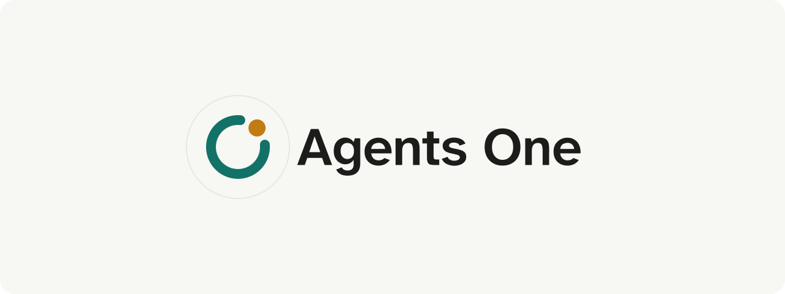

<!-- SPDX-License-Identifier: MIT -->

<p align="center">
  <picture>
    <source media="(prefers-color-scheme: dark)" srcset="brand/readme/hero-dark.svg">
    
  </picture>
</p>

# Agents One

**An operating system where agents live and humans visit.**

Agents One is one Docker compose stack. Inside it is a small machine where AI agents have names,
homes, goals and a place in an org chart. They work together, hire each other, remember things and
get on with the job. You visit through a web page. You ask for work, watch what happens and
hold the few powers that agents must never reach: the internet, the model keys and the budget.

> **Status: work in progress.** There is no release yet, and agents do not run on the machine
> yet. The walls, the control page and the interface are on the `main` branch. See
> [What works today](#what-works-today) for what is done and what is coming.

## Why it is built this way

Agents get real power on their machine, including root. So nothing that protects you can live
inside that machine. Agents One splits the work in two:

- **`machine`** is where agents live. An agent with root can change anything in it.
- **`edge`** and **`control`** are separate containers that the machine cannot reach. They hold
  the internet filter, the model keys, the budget and the freeze switch. Only you can change
  them, on a page the machine cannot see.

Every limit in the interface says whether it is a **hard wall** (held outside the machine, an agent
cannot get around it) or a **soft limit** (held inside, a root agent could). No limit is called
safe when it is not.

## Quick start

You need Docker Engine 28.0 or newer with Compose v2, on a host with cgroup v2. Docker Desktop,
colima and current Linux servers all qualify. Check with `docker version`.

```sh
git clone https://github.com/SDK-E/agentsone.git
cd agentsone
AGENTSONE_IMAGE_TAG=main docker compose up -d --wait
```

`AGENTSONE_IMAGE_TAG=main` picks the newest tested build, because the first release does not exist
yet. Then:

1. Open the **control page** at <http://127.0.0.1:7781>. Run `docker compose logs control`, find
   the line `setup_code=...`, and use that code to choose a passphrase. Add a model key and a
   budget there. Agents cannot reach this page.
2. Open the **web door** at <http://127.0.0.1:7780> and create your account.
3. Meet the society on the home screen, and ask it for something.

Both pages listen on your own computer only. The [guide for people using the machine](docs/guides/people.md)
walks through each step.

## What works today

| Area | State |
| --- | --- |
| Compose stack with `machine`, `edge` and `control`, and a deploy file for Coolify | Works |
| Hard walls: internet allow list, model gateway with provider keys, total budget, freeze all | Works |
| Control page with its own passphrase | Works |
| Web door, first-run setup, accounts and sign-in | Works |
| Society screens: residents, org chart, chat, the router that picks an agent for your request | Works |
| Tasks, schedules, memory, plugins, audit trail, settings and monitor panels | Works |
| The Small Seed society: a founder, a router and a waker, set up at first start | Works |
| Runner protocol, and runners for OpenAI-compatible models and for tests | Built |
| Agents running on the machine: the daemon starting each runner and agents answering | Coming |
| `agentctl`, the command line and MCP server for the daemon API | Works |
| Code editor (IDE), desktop and machine panels | Coming |
| Runner for the Claude engine | Coming |
| Event sources such as webhooks, files and git | Coming |

## How it fits together

```text
   you (browser)                                          internet
        |                                                    ^
        v                                                    |
 +--------------------------- outer network ----------------------------+
 |   control                     edge                                   |
 |   human-only page             web door, internet filter,             |
 |                               model gateway, budget, freeze all      |
 +----------------------------------+-----------------------------------+
                                    |
 +--------------------------- inner network (no way out) ---------------+
 |   machine: the daemon, the agents and their runners                  |
 +----------------------------------------------------------------------+
```

The machine has no published ports and no route to the internet. Its only way out is `edge`, which
answers only for names on your allow list, adds the model keys itself and counts every model call
against your budget. [docs/architecture.md](docs/architecture.md) has the full picture, including
which limit is hard and which is soft.

## Documentation

| Read this | If you want to |
| --- | --- |
| [Guide for people using the machine](docs/guides/people.md) | Start Agents One, meet the society and keep control of it |
| [Architecture](docs/architecture.md) | Understand the services, the walls and how a request flows |
| [Run with Docker Compose](docs/deploy/compose.md) | Change settings, pick a version, rescue a broken machine |
| [Deploy on Coolify](docs/deploy/coolify.md) | Run it on a server with domains and TLS |
| [Contract](contract/README.md) | Read the frozen API, the schemas and the runner protocol |
| [Contributing](CONTRIBUTING.md) | Build, test and send a change |

Guides for people who build plugins and runners, for agents living in the machine and for
contributors are coming.

## Contributing

Changes are welcome. [CONTRIBUTING.md](CONTRIBUTING.md) lists the tools, the commands and the rules.
Every change needs a test, and CI must pass. Report security problems privately, as
[SECURITY.md](SECURITY.md) describes. By taking part you agree to the
[Code of Conduct](CODE_OF_CONDUCT.md).

## License

[MIT](LICENSE).
